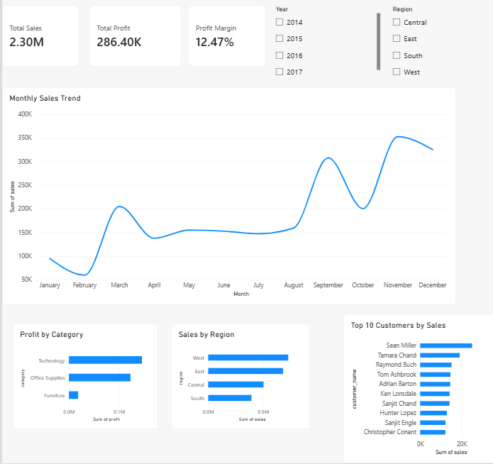

# Retail Sales Analytics: SQL Server + Python ETL + Power BI

End-to-end analytics project: a Python ETL pipeline loads the Superstore sales
dataset into a SQL Server star schema, with SQL views and a stored procedure
feeding an interactive Power BI dashboard.

## Tech stack
Python (pandas, SQLAlchemy, pyodbc) | SQL Server Express | SSMS | Power BI Desktop

## Pipeline
1. **Extract:** read the raw CSV with pandas.
2. **Profile and clean:** null counts, duplicate check, date parsing, key validation
   (see `profiling_output.png`).
3. **Transform:** split into a star schema.
4. **Load:** write the tables to SQL Server (`RetailDW`).
5. **Serve:** SQL views and a stored procedure.
6. **Visualize:** Power BI dashboard on top of the warehouse.

## Star schema
- **fact_sales:** one row per product line within an order (sales, quantity, discount, profit)
- **dim_customer, dim_product, dim_location, dim_date**

## SQL layer (`schema_and_views.sql`)
- `vw_monthly_sales_by_region`: monthly sales and profit by region
- `vw_product_profit_rank`: product profit ranked within category using `RANK() OVER`
- `usp_sales_by_year @year`: stored procedure returning sales and profit by region and category

## Dashboard
KPI cards (Total Sales, Total Profit, Profit Margin), monthly sales trend,
profit by category, sales by region, top 10 customers, and slicers for year and region.

## Data quality note
Some Product IDs map to multiple product names in the source data;
`dim_product` keeps one row per Product ID.

## How to run
1. Create a database: `CREATE DATABASE RetailDW;`
2. Download the Superstore dataset from Kaggle and place the CSV next to `etl.py`.
3. `pip install pandas sqlalchemy pyodbc`
4. Run `python etl.py`, then run `schema_and_views.sql` in SSMS.
5. Open `RetailSales.pbix` and refresh the data source.

Data: public Superstore sample dataset (Kaggle).